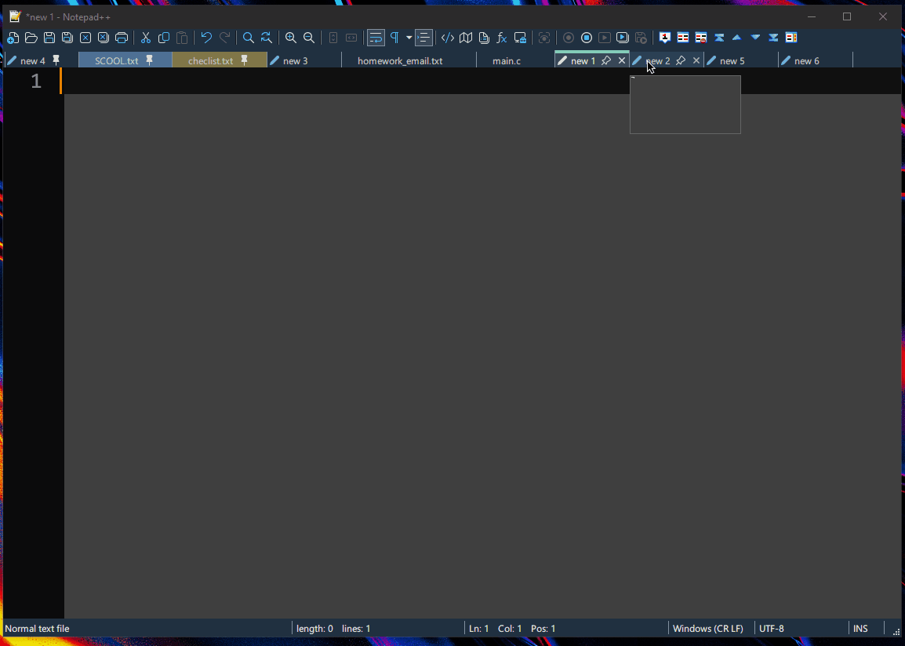
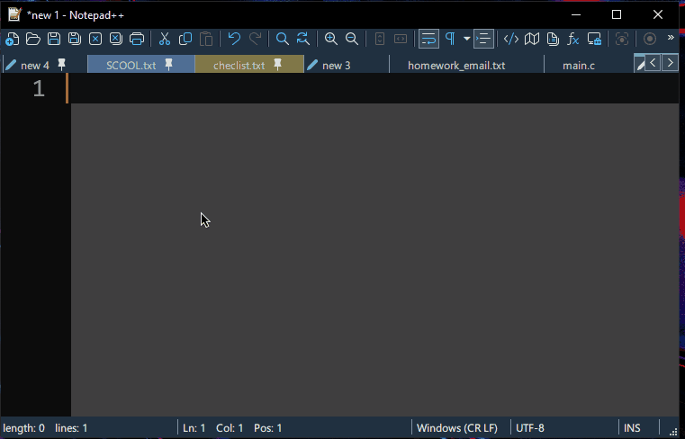
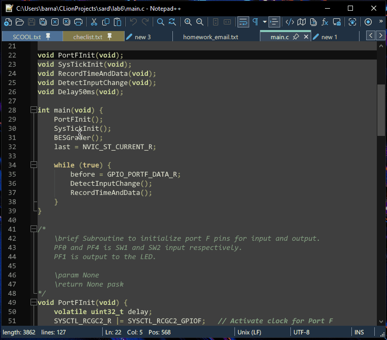
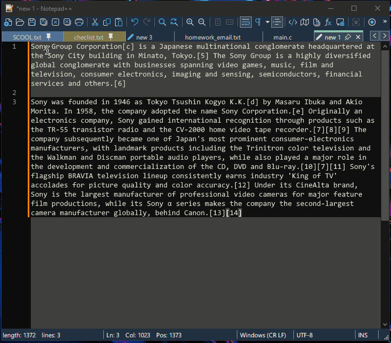
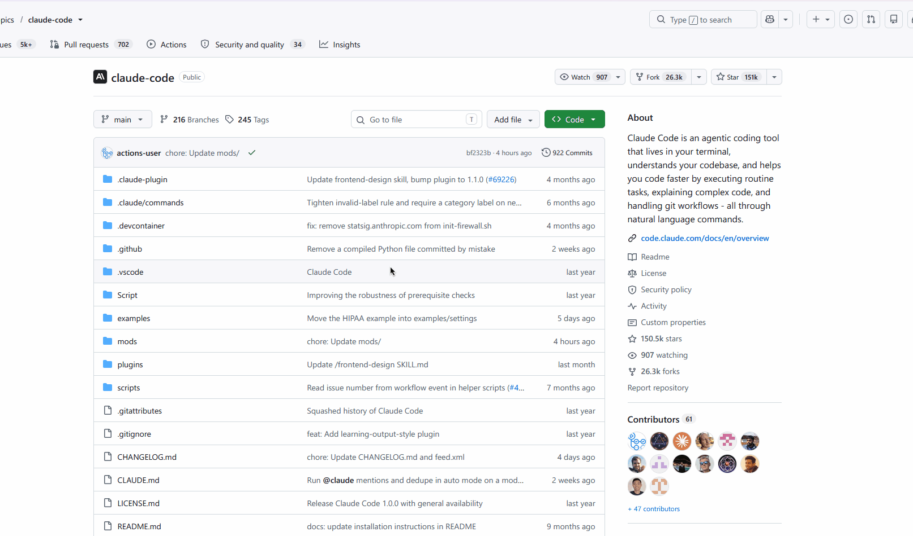
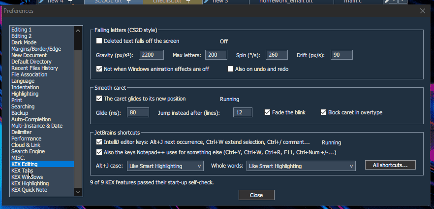

  

<h1 align="center">Notepad++ KEX</h1>

  <em>The Notepad++ you know, with four views, a gliding caret and a dozen small upgrades built right in.</em>

  
  &nbsp;
  
  &nbsp;
  
  &nbsp;
  

Ever needed a third file open next to the two you're comparing? Wished the caret slid where you clicked instead of teleporting, or that <kbd>Alt</kbd>+<kbd>J</kbd> worked like it does in IntelliJ?

**Notepad++ KEX** is Notepad++ with all of that built in. It is still Notepad++ underneath: the same menus, themes, settings and plugins. It just does more, and every extra has its own on/off switch, so you keep exactly the parts you like.

<a href="#what-you-get">Features</a> · <a href="#see-it-in-action">See it in action</a> · <a href="#install">Install</a> · <a href="#common-questions">FAQ</a> · <a href="#licence">Licence</a>

## What you get

- **Four views instead of two.** Work on up to four files side by side in a 2×2 grid. Move or clone any tab to any view, and rotate the whole grid from the middle splitter.
- **Tab snapping.** Grab a tab and pull: it lifts off the bar and follows your mouse. Near the edge of a view, a preview shows where the new view will open. Hold <kbd>Ctrl</kbd> to clone instead of move, or press <kbd>Esc</kbd> to cancel.
- **Snap-out windows.** Drag a tab outside Notepad++ and that view becomes a window of its own. Close it, or drop it back on the tab bar, and it snaps back in.
- **Smooth caret.** The caret glides to its new spot as you type and click, instead of jumping there.
- **Falling letters.** Text you delete drops off the screen, CS2D style.
- **JetBrains shortcuts.** The IntelliJ editor keys: <kbd>Alt</kbd>+<kbd>J</kbd> next occurrence, <kbd>Ctrl</kbd>+<kbd>W</kbd> extend selection, <kbd>Ctrl</kbd>+<kbd>/</kbd> comment, <kbd>Ctrl</kbd>+<kbd>D</kbd> duplicate, <kbd>Ctrl</kbd>+<kbd>Y</kbd> delete line, <kbd>Shift</kbd>+<kbd>Alt</kbd>+<kbd>↑</kbd>/<kbd>↓</kbd> move line, and more.
- **Live token styles.** *Style All Occurrences of Token* keeps up with you: words you type or paste later get the colour too. Tokens can also be bold or italic, even in plain text, and every file remembers its styled tokens.
- **Quick note.** Press <kbd>Ctrl</kbd>+<kbd>Alt</kbd>+<kbd>M</kbd> anywhere in Windows and a small note fades in over whatever you're doing. Press it again and you're right back. What you type is saved as you go.
- **A Notepad++ on every virtual desktop.** Start Notepad++ on a desktop that doesn't have one and a new window opens right there with the same tabs, instead of throwing you back to the other desktop.
- **F12 hover tabs.** In distraction-free F12 mode, touch the top edge of a view to see its tabs.
- **Glass text area.** Windows' live blur (or acrylic) shows through behind your text, while the menus, toolbar and tabs stay solid.
- **A switch for everything.** Each feature can be turned on and off from the KEX group at the bottom of the *Settings* menu, and has its own page in *Preferences*. Changes apply at once. Everything except glass starts switched on.
- **Always on the latest Notepad++.** Every new Notepad++ release gets its own KEX build automatically, and KEX can install it for you.

## See it in action

### Smooth caret

The caret slides from letter to letter and line to line.

### JetBrains shortcuts and falling letters

<kbd>Alt</kbd>+<kbd>J</kbd> picks the next `void`, one delete removes both, and the letters tumble away. Then both spots get `int` at once.

### Live token styles

Style a word once and it stays styled, including every new time you type it. Bold and italic are right there in the same menu.

### Quick note

One hotkey, over any app. Jot it down, press it again, carry on.

### Every feature, your call

Each KEX page in *Preferences* shows its features with an on/off tick, their settings, and whether they're running.

## Install

1. Download `Notepad++-<version>-KEX.zip` from the [latest release](https://github.com/SirBarnaby/notepadpp-kex/releases/latest).
2. Right-click it > *Properties* > tick **Unblock**, then extract it.
3. Pick how you want to use it:
   - **Try it first:** run `notepad++.exe` from that folder. It keeps its own settings there and leaves your installed Notepad++ alone.
   - **Make it your Notepad++:** double-click **Install-KEX.cmd**. Your settings, sessions and plugins stay. At the end it asks whether to install new releases automatically; say yes and you never have to come back here.

Changed your mind? **Uninstall-KEX.cmd** puts the official `notepad++.exe` back. Full details are in `KEX-README.txt` inside the zip.

> **Heads-up:** the first time, Windows may say "unknown publisher", because this build isn't signed. If your Notepad++ needs updating first, the installer downloads the official one from Notepad++'s own GitHub and checks its signature before running it.

## Common Questions

**What happens when Notepad++ releases a new version?**  
A KEX build of it follows automatically, usually within a day. If you turned on automatic updates, it installs itself the next time you close Notepad++ and lets you know. Notepad++'s own updater is switched off in KEX, so it can't quietly swap your build for one without the extras. In the rare case a release changes Notepad++ too much, you simply keep the version you have until KEX catches up.

**Will my plugins still work?**  
Yes. Plugins work in views 1 and 2 exactly as before. Older plugins only know about two views, so while view 3 or 4 has focus their commands are paused with a message, and they never edit the wrong file. Plugin authors can opt in to all four views: see [`include/KexApi.h`](include/KexApi.h) and export `kexAware()`.

**I liked <kbd>Ctrl</kbd>+<kbd>Y</kbd> as redo.**  
Open *Settings* > *KEX Editing* > *Preferences...* and untick *Also the keys Notepad++ uses*. Notepad++'s own <kbd>Ctrl</kbd>+<kbd>Y</kbd>, <kbd>Ctrl</kbd>+<kbd>W</kbd>, <kbd>Ctrl</kbd>+<kbd>R</kbd>, <kbd>F11</kbd> and zoom keys come back, and the rest of the JetBrains keys stay.

**The glass doesn't show up.**  
It's off until you tick it in *Settings* > *KEX Windows*, and it needs Windows' *Transparency effects* turned on (*Settings* > *Personalization* > *Colors*). On Windows 10, the *Acrylic* style can lag while you drag the window; *Blur* is the lighter choice.

**Is this an official Notepad++ release?**  
No. Notepad++ KEX isn't affiliated with the Notepad++ project. It's built from the official source of each Notepad++ release.

Found a bug or have an idea? [Open an issue](https://github.com/SirBarnaby/notepadpp-kex/issues). Hope you have fun with it.

## Licence

GPL v3, like Notepad++ (see [LICENSE](LICENSE)).
